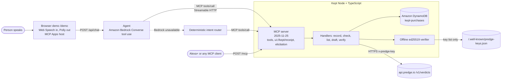

# Kept: did Alexa get what you paid for?

Alexa+ now buys tickets and services for you. **Kept** is a self-hosted **MCP server** that records every purchase the agent makes, checks the merchant's confirmation against what was promised, and returns a **signed verdict that verifies offline**. If something did not arrive, it drafts a refund request, but only after the human says yes. **Kept never moves money.**

Built for the *Build, Ship, Shape: Amazon Developer Hackathon* (Alexa+ track, AWS Builder and Open Source mini challenges). MIT licensed. A simulated Alexa+ web experience (`/demo`) runs the agent on Amazon Bedrock, stores the journal in Amazon DynamoDB and speaks with Amazon Polly. It has **not** been tested on a physical Alexa+ device.

| A person says | MCP tool | What happens |
|---|---|---|
| "Alexa, buy two tickets for Saturday's 7pm show." | `record_purchase` | Saves merchant, item, amount and the details the merchant promised (`ticket_id`, `seat`, `showtime`), keyed by household |
| "Did my tickets arrive?" | `check_purchase` | Builds a job spec from `promised`, sends the merchant's confirmation to Predge `POST /v1/verdicts` (header `x-predge-key`), answers in one sentence: *"A ticketing service confirmed the order but sent no seat. Not delivered; I'd ask for a refund of $32."* |
| "What did you buy for me this week?" | `list_purchases` | Reads the journal across sessions: 2 delivered, 1 refund requested |
| "Ask them for a refund." | `draft_refund_request` | MCP **elicitation** asks "Draft a refund request? Yes / No". Drafts the message with the verdict link only after Yes. Nothing is sent. |
| "Verify that receipt." | `verify_receipt` | Checks the ed25519 signature locally against Predge's published keys (`predge-verify`). Change one character and it fails. |

Every tool returns a short sentence that can be read aloud (`content[0].text`) and details as `structuredContent`. Tools also point to an **MCP App** receipt card (`ui://kept/receipt`, `_meta.ui.resourceUri`) that the demo renders as an Echo Show style card: red NOT DELIVERED, what is missing, the refund amount and a Request refund button.

All demo merchants are generic ("a ticketing service", "a home-cleaning service"); every merchant confirmation in the demo is a **sample** and is labelled as one. Verdicts come from the live [Predge API](https://api.predge.io); nothing is mocked outside the tests.

## What is live and what falls back

| Piece | Live when | Otherwise (labelled in the UI and `/healthz`) |
|---|---|---|
| Verdicts | `PREDGE_KEY` set: signed verdict from `api.predge.io` | Offline sample check, **unsigned**, says so in the sentence and on the card |
| Journal | AWS credentials present: DynamoDB table `kept-purchases` (on-demand) | In-memory, with the reason |
| Agent | Bedrock Converse works (`BEDROCK_MODEL_ID`) | Deterministic intent router calling the same MCP tools; badge shows which ran |
| Voice | Polly neural voice via `/api/tts` | Browser speech synthesis |
| Elicitation | Client declares the `elicitation` capability | Tool asks for confirmation; drafts only when called again with `confirmed: true` after a spoken yes |

## Architecture



## MCP endpoint and protocol version

- Endpoint: `POST http://localhost:8787/mcp`, Streamable HTTP. SDK `@modelcontextprotocol/sdk` 1.32.x; negotiates **2025-11-25** (also 2025-06-18, 2025-03-26, 2024-11-05, 2024-10-07). `GET /healthz` prints the values.
- Default mode uses sessions (`Mcp-Session-Id`) so a tool can ask the human a question with elicitation. `MCP_STATELESS=1` restores one fresh server per request (no elicitation; fits Lambda). A request without a session id is served statelessly either way, so a plain `curl` works.
- Optional auth for a public deployment: `MCP_AUTH_TOKEN`, clients send `Authorization: Bearer <token>`.

```bash
curl -s localhost:8787/mcp -H 'content-type: application/json' -H 'accept: application/json, text/event-stream' \
  -d '{"jsonrpc":"2.0","id":1,"method":"tools/call","params":{"name":"record_purchase","arguments":{"merchant":"a ticketing service","item":"two tickets","amount_usd":32,"promised":["ticket_id","seat","showtime"]}}}'
```

Claude Desktop (or any MCP client) can use the same server, for example through `mcp-remote`: `npx mcp-remote http://localhost:8787/mcp`. Not tested on a physical Alexa+ device.

## Run locally

```bash
npm i
export PREDGE_KEY=...            # optional; never commit it
AWS_PROFILE=predge npm run dev   # or just: npm run dev (memory store, router agent, offline sample verdicts)
# MCP:   http://localhost:8787/mcp
# Demo:  http://localhost:8787/demo   (Chrome or Safari for voice; typing works everywhere)
```

| Variable | Default | Purpose |
|---|---|---|
| `PORT` | `8787` | HTTP port |
| `PREDGE_API` | `https://api.predge.io` | Predge API base |
| `PREDGE_KEY` | unset | Pilot key for `check_purchase` (sent as `x-predge-key`). Without it the tool runs the labelled offline sample check. |
| `KEPT_STORE` | `auto` | `auto` uses DynamoDB when AWS credentials exist, `memory` forces memory, `dynamodb` forces DynamoDB. A DynamoDB error drops to memory and `/healthz` says why. |
| `KEPT_TABLE`, `KEPT_HOUSEHOLD` | `kept-purchases`, `household-demo` | Table name and default household key |
| `BEDROCK_MODEL_ID` | `us.anthropic.claude-sonnet-4-5-20250929-v1:0` | Bedrock model or inference profile for the demo agent. Must be enabled for your account. |
| `AWS_REGION`, `AWS_PROFILE` | `us-east-1` | Standard AWS SDK chain. No keys in this repo. |
| `POLLY_VOICE` | `Joanna` | Neural voice for `/api/tts` |
| `AGENT_FORCE_FALLBACK` | unset | `1` skips Bedrock and uses the router |
| `ENABLE_MARKET_TOOLS` | off | Legacy tools from an earlier version of this repo; not part of Kept |
| `MCP_STATELESS`, `MCP_AUTH_TOKEN` | unset | See above |

The DynamoDB table (partition key `household` S, sort key `id` S, on-demand):

```bash
aws dynamodb create-table --region us-east-1 --table-name kept-purchases \
  --attribute-definitions AttributeName=household,AttributeType=S AttributeName=id,AttributeType=S \
  --key-schema AttributeName=household,KeyType=HASH AttributeName=id,KeyType=RANGE --billing-mode PAY_PER_REQUEST
```

Tests and checks:

```bash
npm test            # vitest, Predge and DynamoDB mocked, no network
npm run smoke       # starts the server, drives the five tools over MCP (offline sample path without PREDGE_KEY)
npm run demo-check  # with the server running: replays the demo requests through /api/chat
```

## Tools

### `record_purchase`
`merchant`, `item`, `amount_usd`, `promised` (JSON dot paths the confirmation must contain), optional `due_by`, `household`. Stores the purchase with status `recorded`. Does not buy anything.

### `check_purchase`
`confirmation` (JSON object or text), optional `purchase_id` (default: latest unchecked). Maps `promised` to `required_fields` and `non_empty_fields` of the documented verdict job spec and posts it (`/v1/verdicts`, or `/v1/verdicts/large` from $1, as the API defines its tiers). The checks are deterministic, no LLM, and the verdict is only as true as the confirmation supplied: Predge does not observe the delivery. The journal entry becomes `delivered`, `not_delivered` or `inconclusive`. Without `PREDGE_KEY` (or if the API is unreachable) the tool says so and runs a local, unsigned sample check.

### `list_purchases`
Optional `days`, `only_open`. Sentence plus the journal as `structuredContent`.

### `draft_refund_request`
Optional `purchase_id` (default: latest not-delivered). Elicits a yes/no from the human, then stores a draft that links the verdict. Only for purchases found not delivered. It is never sent and moves no money.

### `verify_receipt`
Optional `purchase_id`, `verdict_id`, `receipt` (the attestation), `demo_tamper`. Downloads Predge's published key list and checks the ed25519 signature over `attestation.canonical` with `node:crypto`, reads the key's status. Results: `authentic`, `key_revoked`, `invalid_signature`, `unknown_key`, `malformed`. The same check is available as the standalone open-source library [predge-verify](https://github.com/predgeAI/predge-verify).

## AWS services used

- **Amazon Bedrock (Converse API)**, `src/agent.ts`: Claude via `@aws-sdk/client-bedrock-runtime`, model from `BEDROCK_MODEL_ID`. The MCP tool list becomes Converse `toolConfig`; the loop runs `toolUse` -> MCP `tools/call` -> `toolResult` (max 5 rounds). If Bedrock is unreachable or the model is not enabled, the log prints `[agent] path=fallback reason=...` and the UI badge says "deterministic router (Bedrock not used)".
- **Amazon DynamoDB**, `src/store.ts`: table `kept-purchases`, on-demand, key `household` + `id`.
- **Amazon Polly**, `src/server.ts` `/api/tts`: neural voice for the demo's replies.
- Credentials come from the standard SDK chain. Lambda deployment is not done; the stateless mode is meant for it.

## Layout

```
src/server.ts   Express: /mcp (sessions or stateless), /api/chat, /api/tts, elicitation relay, /demo, /healthz
src/mcp.ts      MCP server: 5 tools, ui://kept/receipt resource, elicitation
src/kept.ts     record / check / list / draft / verify handlers
src/store.ts    DynamoDB and in-memory journal, automatic fallback
src/card.ts     MCP App receipt card (HTML)
src/agent.ts    Bedrock Converse agent + deterministic router (both call MCP tools)
src/samples.ts  Demo purchases and sample merchant confirmations (generic merchants)
src/verify.ts   Canonical JSON + ed25519 verification
src/tools.ts, src/predge.ts   Verdict request builder, offline record verifier, Predge client
demo/index.html Simulated Alexa+ page and MCP Apps host
```

See also `DEMO.md`, `FRICTION_LOG.md`, `PRODUCT_FEEDBACK.md`.

## License

MIT. See `LICENSE`.
