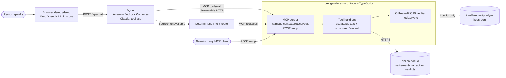

# predge-alexa-mcp

A self-hosted **MCP server** (Streamable HTTP) that lets a voice assistant such as Alexa+ ask Predge three questions it cannot answer on its own, plus a **simulated Alexa+ web demo** that runs an **Amazon Bedrock** agent on top of the server.

Built for the *Build, Ship, Shape: Amazon Developer Hackathon* (Alexa+ track, AWS Builder and Open Source mini challenges). MIT licensed.

| Question a person asks | MCP tool | Predge API behind it |
|---|---|---|
| "Is the Russia-Ukraine peace talks market safe to cash out?" | `check_market_settlement` | `GET /v1/settlement-risk/:market` (free, signed) |
| "What markets are in dispute right now?" | `active_disputes` | `GET /v1/settlement-risk/active` (free) |
| "Did the work I paid for actually arrive?" | `verify_delivery` | `POST /v1/verdicts` (pilot key, signed verdict) |
| "Is that record genuine?" | `verify_record` | `GET /.well-known/predge-keys.json`, then ed25519 check **locally** |

Every tool returns a short sentence that can be read aloud (`content[0].text`) and the full details as `structuredContent`.

All data comes from the live [Predge API](https://api.predge.io) ([docs](https://github.com/predgeAI/predge-x402-api/tree/main/docs), `openapi.json`). Nothing is mocked outside the tests.

## Architecture



The demo agent is a real MCP client: it connects to the server's own `/mcp` endpoint over HTTP, so what you see in the right-hand panel are genuine `tools/call` results.

## MCP endpoint and protocol version

- Endpoint: `POST http://localhost:8787/mcp` (Streamable HTTP, JSON responses, stateless: a fresh server per request, so it scales horizontally; `GET`/`DELETE` answer `405`).
- SDK: `@modelcontextprotocol/sdk` **1.32.1**. Its `LATEST_PROTOCOL_VERSION` is **`2025-11-25`**, and it also accepts `2025-06-18`, `2025-03-26`, `2024-11-05`, `2024-10-07`. A client that asks for `2025-11-25` gets `2025-11-25` (checked in `test/mcp.test.ts`; `GET /healthz` prints the values).
- Optional auth for a public deployment: set `MCP_AUTH_TOKEN` and clients must send `Authorization: Bearer <token>`.

```bash
curl -s localhost:8787/mcp -H 'content-type: application/json' -H 'accept: application/json, text/event-stream' \
  -d '{"jsonrpc":"2.0","id":1,"method":"tools/call","params":{"name":"check_market_settlement","arguments":{"market":"Russia-Ukraine peace talks"}}}'
```

## Run locally

```bash
npm i
cp .env.example .env        # optional; export the variables below in your shell
AWS_PROFILE=predge npm run dev   # or just: npm run dev
# MCP:   http://localhost:8787/mcp
# Demo:  http://localhost:8787/demo   (Chrome or Safari for voice; typing works everywhere)
```

| Variable | Default | Purpose |
|---|---|---|
| `PORT` | `8787` | HTTP port |
| `PREDGE_API` | `https://api.predge.io` | Predge API base |
| `PREDGE_KEY` | unset | Pilot key for `verify_delivery` (sent as `x-predge-key`). Without it that tool says so and makes no call. Never commit it. |
| `BEDROCK_MODEL_ID` | `us.anthropic.claude-sonnet-4-5-20250929-v1:0` | Bedrock model or inference profile for the demo agent. Must be enabled for your account. |
| `AWS_REGION` | `us-east-1` | Bedrock region |
| `AWS_PROFILE` etc. | | Standard AWS SDK credential chain. No keys in this repo. |
| `AGENT_FORCE_FALLBACK` | unset | `1` skips Bedrock and uses the router |
| `MCP_AUTH_TOKEN` | unset | Require a bearer token on `/mcp` |

Tests and checks:

```bash
npm test            # 36 unit/integration tests, Predge mocked, no network
npm run smoke       # live: starts the server, calls the real free Predge routes over MCP
npm run demo-check  # with the server running: replays the demo utterances through /api/chat
```

## Tools

### `check_market_settlement`
Input `market`: a spoken name, Polymarket URL, slug, numeric id or `0x` condition id. IDs and slugs go straight to the API; a spoken name is matched against Predge's public dispute list (`/v1/settlement-risk/active`), so name lookup works for markets that have been disputed in the last 30 days. Anything else needs a link/slug.

> "Russia-Ukraine peace talks by October 31, 2026?" is disputed and went to a UMA vote; don't treat it as settled yet. It was disputed twice, most recently 22 hours ago.

The sentence is chosen from the signed record's own fields (`resolved_on_chain`, `open_dispute`, `sent_to_uma_vote`, `current_proposal`, `dispute_count`). Not financial advice.

### `active_disputes`
Input `limit` (default 5), `topic` (optional words). Open disputes newest first, with the counts from the tracker.

### `verify_delivery`
Flat input (endpoint, amount, delivered status/body, optional expected content type, required fields, latency, hash) mapped to the documented `POST /v1/verdicts` body (`/v1/verdicts/large` at $1 or more). Returns `delivered`, `not_delivered` or `inconclusive`, the failed checks in plain words, a refund **recommendation** (Predge does not move money in this version) and `verify_url`. The checks are deterministic and the verdict is only as true as the evidence supplied. Needs `PREDGE_KEY`.

### `verify_record`
Input one of `market`, `verdict_id` or `record`. Downloads Predge's published key list, rebuilds nothing from the server's word: it checks the ed25519 signature over `attestation.canonical` with `node:crypto`, checks that the readable `payload` canonicalizes to the signed text, and reads the key's status. Results: `authentic`, `key_revoked`, `invalid_signature`, `unknown_key`, `malformed`. `demo_tamper: true` flips one character first, to show tampering is caught (demo only).

## How Alexa+ would connect

The Alexa+ track asks for a self-hosted MCP server. This server speaks standard MCP over Streamable HTTP, so any MCP client that can reach a public HTTPS URL for `/mcp` can use it: deploy it (below), register that URL where the assistant takes its tools, and the four tools above are listed by `tools/list` with speakable descriptions. We have not run it against a physical Alexa+ device; the web demo plays the Alexa+ role (voice in, agent, MCP tools, voice out).

## AWS services used

- **Amazon Bedrock (Converse API)** in `src/agent.ts`: Claude via `@aws-sdk/client-bedrock-runtime`, region `us-east-1`, model from `BEDROCK_MODEL_ID`. The MCP tool list is converted into Converse `toolConfig`; the loop runs `toolUse` -> MCP `tools/call` -> `toolResult` until the model answers (max 5 rounds). Credentials come from the standard AWS SDK chain.
- If Bedrock is unreachable or model access is not enabled, the agent logs `[agent] path=fallback reason=...`, the UI badge changes from "Amazon Bedrock" to "fallback router", and a deterministic router calls the same MCP tools, so the demo still works.

## Deploy note (AWS App Runner), not performed

Nothing in this repo creates AWS resources. To host it yourself: build the included `Dockerfile`, push the image to ECR, create an App Runner service on port 8080, give its instance role `bedrock:InvokeModel` for your model, and set `PREDGE_KEY` (as a secret), `MCP_AUTH_TOKEN`, `BEDROCK_MODEL_ID`, `AWS_REGION`. App Runner and ECR are billed services; check pricing first.

## Layout

```
src/server.ts   Express app: /mcp (Streamable HTTP), /api/chat, /demo, /healthz
src/mcp.ts      MCP server and the four tool registrations
src/tools.ts    Tool handlers, market resolver, spoken summaries
src/predge.ts   Predge API client (fetch injectable for tests)
src/verify.ts   Canonical JSON + ed25519 verification (node:crypto)
src/agent.ts    Bedrock Converse agent + fallback router (both use MCP tools/call)
demo/index.html Simulated Alexa+ page (Web Speech API)
test/           vitest, Predge mocked, in-process MCP client
scripts/        smoke.ts (live), demo-check.ts
```

See also `DEMO.md` (shot list), `FRICTION_LOG.md`, `PRODUCT_FEEDBACK.md`.

## License

MIT. See `LICENSE`.
